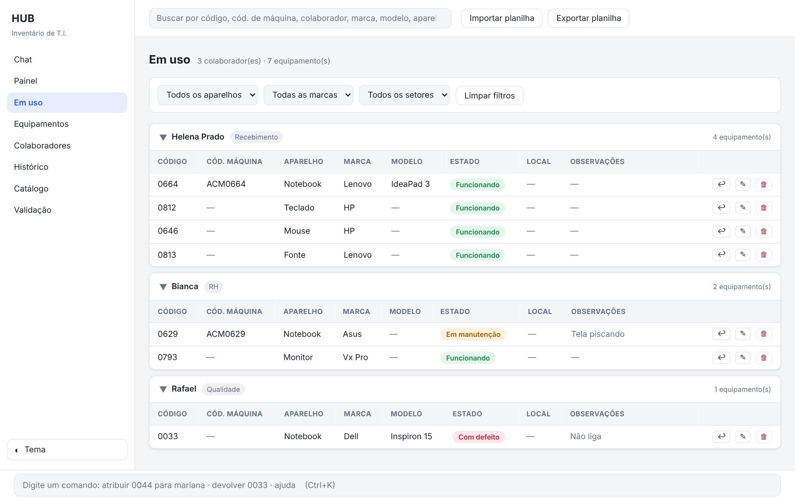
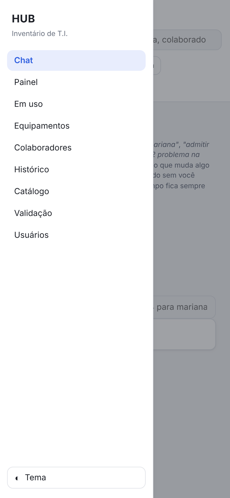
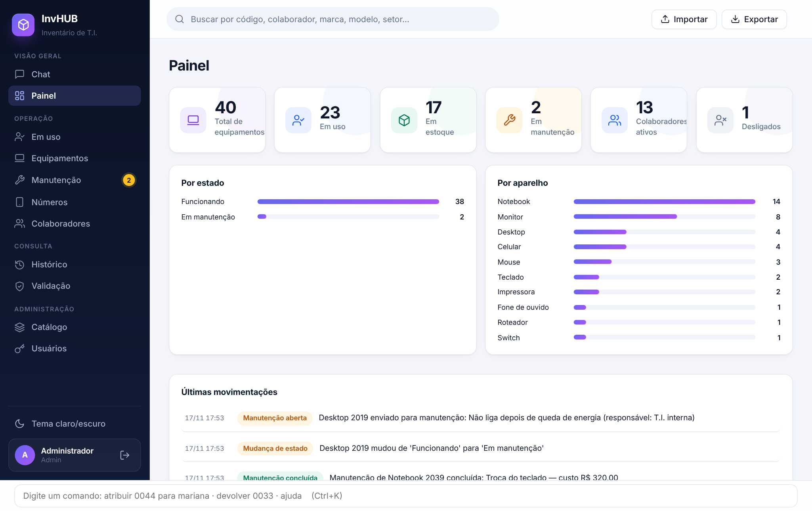
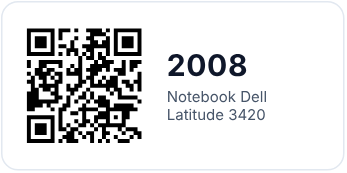
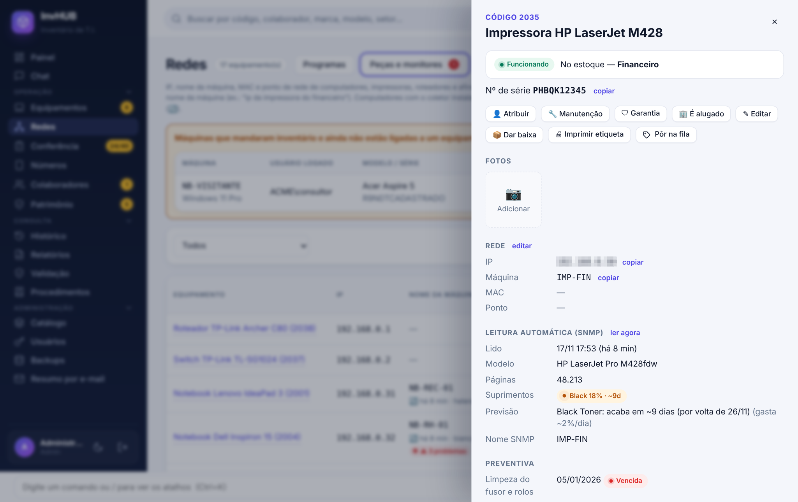

# Histórico da evolução do InvHUB

Do controle de patrimônio em planilha a um sistema web com coleta automática, em cerca
de 3 semanas e 11 versões.

[← Voltar para a página do projeto](../README.md)

---

## Ponto de partida: a planilha

A T.I. controlava os equipamentos numa planilha Excel com três abas: equipamentos em
uso, estoque e listas auxiliares. Os problemas eram:

- sem histórico: não dava para saber com quem um notebook esteve antes;
- códigos repetidos, setores escritos de vários jeitos e observações misturadas com o modelo;
- desligamento de colaborador feito à mão, com equipamento "esquecido" no nome de quem já saiu;
- uma pessoa editando por vez, sem registro de quem mudou o quê.

Antes de escrever código, escrevi uma especificação com as regras de negócio, as telas e
a ordem das fases.

## v01 · Aplicativo de mesa

Programa Windows de um arquivo só, em Python com banco SQLite local e interface em
HTML, CSS e JavaScript. Construído em 11 fases:

- importador que lê a planilha antiga sem perder nenhuma informação;
- telas de equipamentos em uso (agrupados por colaborador), estoque e colaboradores;
- histórico que só aceita inclusão e continua existindo mesmo se o equipamento for excluído;
- admissão, desligamento e readmissão, com os equipamentos voltando ao estoque;
- catálogo de modelos com apelidos ("ip3" = Lenovo IdeaPad 3);
- **chat em português**, com interpretador próprio, sem IA nem internet, e prévia antes de cada ação;
- exportação de volta para a planilha, validador de inconsistências, painel e busca.

**Por que mudou:** o programa só funcionava numa máquina, para uma pessoa. A T.I.
precisava de vários usuários ao mesmo tempo, inclusive no celular, no estoque.

## v02 · Cliente-servidor e celular

- Troca do SQLite pelo **PostgreSQL**
- Login com sessão e **4 perfis de acesso**: Admin, Chefe, Operador (permissões uma a uma) e RH (só leitura)
- **API REST** com FastAPI
- Interface transformada em **PWA**: abre no celular como aplicativo
- Migração dos dados da versão de mesa e implantação num servidor Windows, com backup diário

## v03 · Termos e linhas de celular

- **Termo de responsabilidade gerado automaticamente** a partir do modelo Word da empresa, já com os equipamentos da pessoa
- Controle de chips de celular por colaborador
- Restauração de backup, para trocar de servidor com segurança

## v04 · Manutenção e novo visual

- Abertura e conclusão de manutenção, com solução e custo registrados no histórico
- **Redesenho completo**: menu agrupado, tema claro e escuro, e tabelas que viram cartões no celular

## v05 · Ficha, garantia e etiquetas QR

- **Ficha do equipamento** com dono, histórico, manutenções e garantia num lugar só
- Aviso de garantia vencendo
- Chat com menu de atalhos e assistente passo a passo
- Validação de IMEI dos celulares
- **Etiquetas com QR Code** que abrem a ficha no celular, geradas sem internet

## v06 · Conferência, segurança e documentos

- **Conferência física do inventário** pelo celular, com relatório
- HTTPS na rede interna e câmera ao vivo no leitor
- Bloqueio após tentativas de login erradas, registro de acessos e backups criptografados
- Baixa de equipamentos, fotos e controle de equipamentos alugados
- Relatórios em PDF, Word e Excel
- Termo de devolução e checklist de admissão da T.I.
- Etiquetas no padrão de folha Pimaco

## v07 · Organização e revisão de segurança

- Estoque mínimo por tipo de aparelho, com aviso no painel e no chat
- Abas visíveis por usuário, controladas também no servidor
- **Revisão de segurança e desempenho** de todo o sistema antes de seguir

## v08 · Coleta automática

- **Agente em PowerShell** nos computadores, enviando hardware, Windows e usuário logado a cada 5 minutos
- **Impressoras via SNMP**, com cliente escrito do zero: modelo, páginas e nível de toner
- Baixa automática do toner no estoque quando a impressora mostra que ele foi trocado
- Manutenção preventiva agendada, sugestão de renovação e **resumo semanal por e-mail**

## v09 · Saúde dos computadores

- Avisos de disco quase cheio, Windows desatualizado, antivírus desligado e máquina sem enviar dados
- Lista de programas instalados e de programas não permitidos
- Base de procedimentos da T.I., exibida na ficha dos equipamentos certos

## v10 · Peças, monitores e toner

- **Aviso de peça trocada ou retirada** (memória, disco, processador), sem alarme falso
- Monitores reconhecidos automaticamente e aviso quando mudam de mesa
- **Previsão de fim do toner** a partir do ritmo de uso ("acaba em ~9 dias")

## v11 · Código de barras (versão final)

- A câmera do celular lê **QR Code e código de barras**, também no iPhone e sem internet
- Leitura por pistola: o código abre a ficha ou marca o item na conferência
- Etiqueta com QR, código de barras ou os dois, com gerador Code 128 próprio

---

## Em números

| | |
|---|---|
| Testes automatizados | 512 |
| Python | ~16.800 linhas |
| JavaScript | ~10.900 linhas |
| CSS | ~4.400 linhas |
| Rotas de API | 144 |
| Tabelas no banco | 35 |
